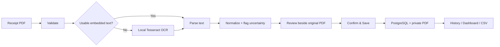

# BEKAL

[](https://github.com/haziqzes/Project-BEKAL/actions/workflows/checks.yml)
[](https://github.com/haziqzes/Project-BEKAL/releases/latest)
[](LICENSE)

**Local-first grocery receipt intelligence for Windows.**

BEKAL turns receipt PDFs into reviewed, structured spending records while keeping household data local. It extracts selectable PDF text when available, falls back to local Tesseract OCR for scanned receipts, lets the user correct the result beside the original PDF, and only saves data after explicit confirmation.

**Current release:** `v0.2.0`  
**Platform:** Windows desktop  
**Creator:** Wan Mohamad Haziq Mirza  
**License:** MIT

## Download

Download the current Windows installer from the [BEKAL v0.2.0 release](https://github.com/haziqzes/Project-BEKAL/releases/tag/v0.2.0).

Installer:

```text
BEKAL_0.2.0_x64-setup.exe
SHA-256: E110665D77686000D872E9FD391C41AC40D21ECEC682CEB7381CD1C9A4895722
```

**Docker Desktop is required** for BEKAL V0.2 because the application still runs FastAPI and PostgreSQL locally in containers. The installer is currently unsigned, so Windows SmartScreen may show a reputation warning. Verify the published SHA-256 before running the installer.

See the [Windows installation guide](docs/installation.md) for the complete setup, launch, upgrade, uninstall, and troubleshooting flow.

## What BEKAL does

- accepts grocery receipt PDFs up to 10 MiB;
- uses embedded PDF text first and local OCR only when necessary;
- extracts receipt metadata and line items conservatively;
- flags missing or uncertain information for human review;
- keeps the original PDF visible while the user edits the candidate;
- supports manual entry when extraction is not useful;
- warns about likely duplicate receipts;
- stores confirmed receipts, items, products, aliases, and categories in PostgreSQL;
- keeps confirmed original PDFs in private local runtime storage;
- provides receipt history with reopen, edit, and delete workflows;
- provides monthly spending/category/product summaries;
- exports UTF-8 `receipts.csv` and `items.csv` files;
- remains MYR-only in the current product scope.

## Core workflow



The original receipt PDF remains the source of truth. Extraction and review data stay temporary until the user explicitly confirms the receipt.

## Privacy model

BEKAL is deliberately local-first.

- No cloud account is required.
- No paid AI or cloud OCR service is required.
- The packaged backend listens only on `127.0.0.1:8000`.
- Packaged PostgreSQL is not exposed on a host TCP port.
- Real receipts, exports, database files, runtime data, and secrets must never be committed to this repository.
- Only synthetic receipt fixtures belong in source control.
- Normal uninstall removes the application but preserves BEKAL private data by design.

Read [Privacy & Security](docs/privacy-security.md) for the full boundary.

## Platform support

| Platform | Status | Notes |
| --- | --- | --- |
| Windows desktop | **Supported** | V0.2 NSIS installer + Tauri desktop shell |
| Browser development mode | **Supported for development** | Docker Compose frontend/backend/PostgreSQL stack |
| Android | Not supported | Windows `.exe` cannot be installed on Android |
| iPhone / iPad | Not supported | No iOS application exists |
| macOS / Linux packaged app | Not released | No supported installer is published |
| Multi-PC sync | Not supported | Each installation currently owns separate local data |

A future mobile or multi-device client would require a separate secure networking/authentication design; it is not part of V0.2.

## Architecture at a glance

```text
Windows user
   │
   ▼
BEKAL.exe (Tauri 2 + bundled React UI)
   │
   ▼
127.0.0.1:8000
FastAPI
   │
   ├── PDF extraction / local OCR
   ├── review / validation logic
   ├── receipt history / dashboard / CSV
   │
   ▼
PostgreSQL + private receipt storage
```

The installed runtime lives outside the source repository under the user's local application-data directory. Docker remains an implementation prerequisite in V0.2, not part of the user-facing data model.

Read [Architecture](docs/architecture.md) for the detailed runtime and data flow.

## Documentation

Start with the [documentation index](docs/README.md).

- [Install BEKAL on Windows](docs/installation.md)
- [User guide](docs/user-guide.md)
- [Architecture](docs/architecture.md)
- [Development guide](docs/development.md)
- [Privacy & Security](docs/privacy-security.md)
- [Roadmap](docs/roadmap.md)
- [Changelog](CHANGELOG.md)
- [Contributing](CONTRIBUTING.md)
- [Security policy](SECURITY.md)

Historical V0.1/V0.2 planning and release-candidate documents are preserved under [`docs/archive/`](docs/archive/README.md). They are kept for engineering history and are not the current user instructions.

## Development quick start

For browser-mode development:

```powershell
git clone https://github.com/haziqzes/Project-BEKAL.git
cd Project-BEKAL
Copy-Item .env.example .env
# Set a local PostgreSQL password in .env
docker compose up --build -d
docker compose exec backend alembic upgrade head
```

Then open `http://localhost:5173`.

Run the core checks with:

```powershell
docker compose exec -T backend pytest -q
python scripts/check_repository_safety.py --history
cd frontend
npm ci
npm run build
npm audit --audit-level=low
```

Desktop development additionally requires Rust/MSVC and the Tauri toolchain. See [Development](docs/development.md).

## Project status

BEKAL V0.1 established and publicly released the receipt-processing core. V0.2 completed the native Windows shell, one-click local service lifecycle, private installed runtime, branded NSIS packaging, owner-machine acceptance, and public Windows release.

The project is currently in **post-release maintenance**. New product scope is not considered part of V0.2 merely because it is useful; future milestones are listed as candidates in the roadmap and require an explicit scope decision.

## Creator

BEKAL is created and maintained by **Wan Mohamad Haziq Mirza**.

The application includes a small `by Wan Haziq` signature as creator credit.

## License

BEKAL is open-source software released under the [MIT License](LICENSE).
